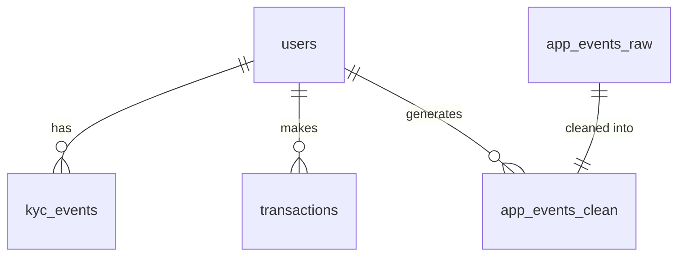

# Data Model (PostgreSQL)

Database: `digital_wallet_kyc`, schema: `wallet`.
The data is synthetic (see `scripts/generate_data.py`, seed 42), so this project shows a method, not real-world findings.

## How the data flows

1. `scripts/generate_data.py` creates raw CSV files in `data/raw`.
2. Python (pandas) cleans users, KYC events and transactions into `data/clean`.
3. The CSV files are loaded into PostgreSQL (`sql/01_create_tables.sql` creates the tables).
4. `app_events` is cleaned in SQL (`sql/02_clean_app_events.sql`).
5. `sql/03_keys_and_indexes.sql` adds foreign keys and indexes.

## Tables

| Table | Rows | What one row is | Key |
|---|---|---|---|
| `users` | 20,000 | one registered user | primary key `user_id` |
| `kyc_events` | 16,792 | one KYC attempt for a user | no primary key; foreign key `user_id` |
| `transactions` | 101,291 | one payment | primary key `transaction_id`; foreign key `user_id` |
| `app_events_raw` | 250,261 | one app event, exactly as generated | none (kept untouched) |
| `app_events_clean` | 249,954 | one app event after cleaning | foreign key `user_id` |
| `date_dimension` | 730 | one calendar day | primary key `date` |

## Relationships

`date_dimension` is a lookup table for dates. It is not linked with a foreign key; queries join it on the date.

## Cleaning decisions

| Table | Problem | Decision |
|---|---|---|
| `users` | duplicates, blank city and age_band | duplicates removed; blanks set to "Unknown" (done in Python) |
| `kyc_events` | 86 rows where completion is before signup or start | kept and flagged with `has_date_issue` (done in Python) |
| `transactions` | 405 duplicate transaction_ids, 120 TEST_USER rows, 25 zero-value payments | duplicates and test rows removed; zero-value payments kept and flagged with `has_amount_issue` (done in Python) |
| `app_events` | 307 exact duplicate rows, 1,218 blank session_ids | duplicates removed; blank session_ids kept and flagged with `has_missing_session` (done in SQL) |

## Checks done

- Row counts in PostgreSQL match the CSV files.
- Orphan check: 0 rows in `kyc_events`, `transactions` and `app_events_clean` have a `user_id` that is missing from `users`.
- Foreign keys now enforce this rule, and indexes speed up lookups by user, date and event name.
